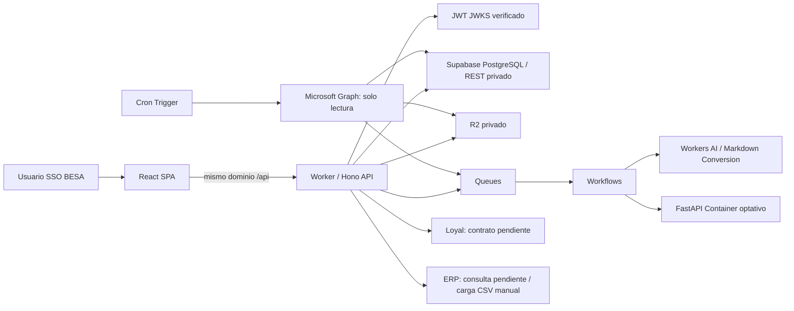

# Arquitectura de referencia

## Flujo

La validación de autenticación es independiente de la autorización por acción y de la membresía de aplicación. La identidad es `sub` (identificador estable), **no el correo**. Solo el backend usa `SUPABASE_SERVICE_ROLE_KEY`. La BD está cerrada para roles de API de navegador. El SSO real debe confirmar el contrato de entrega del token: el código admite JWT Bearer o cookie segura `__Host-besa_sso`; la aplicación nunca crea un login propio.

Los originales se guardan privados en R2; Supabase conserva metadata y extracciones. La IA no recibe herramientas arbitrarias, no escribe al ERP y no declara documentos aprobados. Las extracciones requieren validación humana y bloqueo técnico según Loyal.

## Estado actual vs diseño objetivo

| Subsistema | Implementado | Faltante |
|---|---|---|
| SPA / API | Rutas y pantallas con operaciones | Compilación npm y pruebas con navegador |
| PostgreSQL | Modelo y migración | Aplicación real, pruebas transaccionales, backups |
| SSO | Verificación JOSE y asignación en BD | Contrato real de BESA, redirect, SLO, revocación |
| Microsoft Graph | Adaptador delta y adjuntos solo lectura | Registro Entra, autorización, pruebas, observabilidad |
| Workers AI | Conversión y extracción estructurada | Pruebas reales de precisión por documento y costo |
| Loyal | Interfaz y fail-closed | API real: no se inventaron endpoints |
| ERP | Sin escritura; CSV con mapping validado | Archivo oficial / consulta de maestros |
| Agentes | Registro, estados e instrucciones versionadas | Herramientas, permisos granulares e indicadores por agente |
| Workflows / Queues | Código y configuración base | Provisionamiento de servicios, carga y reintentos reales |
| Containers | Servicio FastAPI y Dockerfile | Imagen, despliegue y binding privado Cloudflare |
| Auditoría | Eventos y trigger append-only | Integridad criptográfica / SIEM / archivado inmutable |
| AI Gateway | Diseño previsto | Binding, políticas de logging/redacción y límites |

## Decisiones

1. PostgreSQL en Supabase y R2 como almacenamiento de archivos: separa registros transaccionales de objetos binarios.
2. Control de accesos central, sin base de contraseñas nueva.
3. Control técnico de Loyal **determinista y fail-closed**, sin confiar en el modelo ni en lo declarado en el documento.
4. Procesamiento asíncrono para no depender del navegador; Queue->Workflow persistente.
5. CSV solo con mapeo oficial validado y carga al ERP manual por Sebastián.
6. Ambiente de demo separado: cualquier comprobación ficticia tiene `source=synthetic`; no puede habilitar aprobaciones productivas.
7. Solo el primer agente (Compras) tiene pipeline concreto; los demás son registros configurables, no automatizaciones terminadas.

## Principales riesgos técnicos

- Token SSO central no inspeccionado: el contrato JWT es una **hipótesis implementada**, no integración certificada.
- API Loyal desconocida: puede exigir transporte distinto de HTTP; sin confirmación, no hay habilitación.
- Importación real del ERP no especificada: mapping ficticio no es usable comercialmente.
- Los archivos Office son ZIP; el parser deberá endurecerse frente a zip-bombs y archivos maliciosos antes de producción.
- En alta concurrencia: las correcciones de línea se hacen por función SQL transaccional; las demás transiciones usan versión optimista pero los efectos R2/BD necesitan reconciliación ante fallos.
- La migración usa Data API server-side con rol privilegiado; evaluar acceso vía conexión PostgreSQL directa o Hyperdrive si se requiere mayor garantía transaccional.
